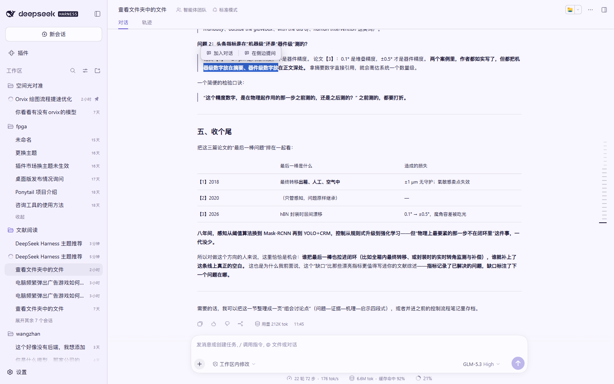
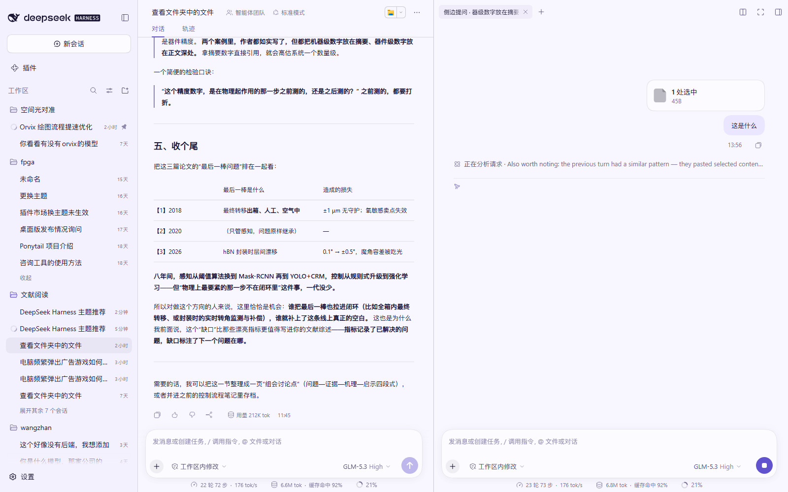
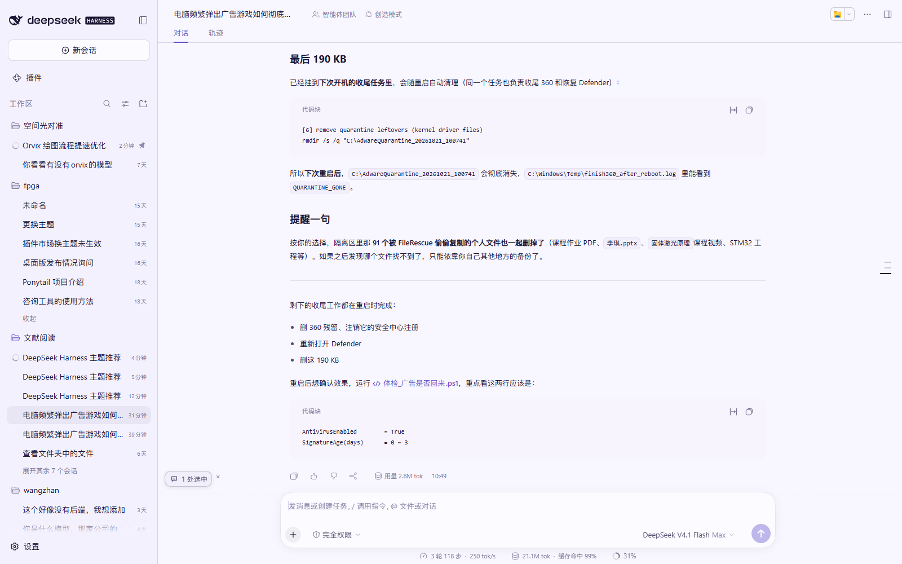

# DeepSeek Harness · 选中操作（Selection Actions）

在 **DeepSeek Harness** 的对话里选中一段文字，立刻可以「**加入对话**」或「**在侧边提问**」——像在 IDE 里选中代码问 AI 一样顺手。

<p>
  
  
  
  
</p>

> English: A DeepSeek Harness plugin that adds selection actions to chat messages — select text and either attach it to the current composer or ask about it in a side chat that reuses one tab and inherits the main conversation context.



## ✨ 特性

- **选中即用**：在任意消息里拖选文字，弹出小工具条：`加入对话` / `在侧边提问`；
- **加入对话**：选中内容以「1 处选中」胶囊出现在主输入框上方，发送时自动作为引用内容带上（没有 `>`、没有多余提示行、没有双引号）；
- **在侧边提问**：在右侧边栏开一个独立侧边对话专门聊这段内容，**不会打断主对话**；
- **知道主对话在聊什么**：侧边对话是主对话的 fork，继承了上下文，但**只显示你新问的那一问和回答**，主对话历史自动隐藏、不刷屏；
- **不往工作区里塞会话**：侧边对话不会在工作区列表里多出一行，关闭标签即归档；
- **一个主对话只开一个侧边标签**：第一次点击打开，之后再次点击「在侧边提问」复用同一个标签，只更新引用内容；
- 中英双语、跟随主题（不覆盖任何主题颜色，只用 DSH 设计系统 token）；
- 纯客户端插件，无第三方依赖、无守护进程、不改动 DSH 本体，禁用即完全还原。

## 🖼 截图

侧边提问：消息以「1 处选中」小芯片附在你的问题气泡上方，下面直接是助手的回答（主对话历史不会出现）：



加入对话：选中内容以胶囊形式挂在主输入框上方，发送时一起带上：



## ⬇️ 安装

### 方式一：一键脚本（推荐）

需要 PowerShell（Windows 自带）。下载本仓库后，在仓库目录执行：

```powershell
powershell -ExecutionPolicy Bypass -File .\install.ps1
```

脚本会：

1. 把插件复制到 `%LOCALAPPDATA%\dsh-selection-actions`；
2. 在当前 DSH profile（默认 `~/.dsh/profiles/desktop`）里登记依赖与 bundle；
3. 创建 `node_modules` 链接。

然后**重启 DeepSeek Harness**（或按 `Ctrl+R` 刷新一次页面）即可生效。

自定义参数：

```powershell
# 指定 DSH 数据目录 / profile 名 / 安装位置
powershell -ExecutionPolicy Bypass -File .\install.ps1 -DshHome "D:\dsh-data" -ProfileName desktop -TargetDir "D:\plugins\dsh-selection-actions"
```

### 方式二：手动安装

1. 把本仓库复制/克隆到一个固定目录，例如 `C:\plugins\dsh-selection-actions`；
2. 编辑 `%USERPROFILE%\.dsh\profiles\desktop\package.json`，在 `dependencies` 中加入：

   ```json
   "@local/dsh-selection-actions": "link:C:/plugins/dsh-selection-actions"
   ```

   在 `dsh.profile.bundles` 数组末尾加入 `"@local/dsh-selection-actions"`；
3. 在 profile 目录创建链接（没有 pnpm 时也可以直接用 junction）：

   ```powershell
   New-Item -ItemType Junction -Path "$env:USERPROFILE\.dsh\profiles\desktop\node_modules\@local\dsh-selection-actions" -Target "C:\plugins\dsh-selection-actions"
   ```

4. 重启 DeepSeek Harness。

> 如果你是用 pnpm/npm 管理 profile，也可以直接 `pnpm add "link:C:/plugins/dsh-selection-actions"`，再把包名加进 `dsh.profile.bundles`。

### 卸载

```powershell
powershell -ExecutionPolicy Bypass -File .\uninstall.ps1
```

或手动：从 profile 的 `dependencies` / `dsh.profile.bundles` 中删掉 `@local/dsh-selection-actions`，删除 `node_modules\@local\dsh-selection-actions` 链接与安装目录，重启 Harness。

## 🎯 使用

1. 在任意对话消息中**用鼠标拖选**一段文字，稍等片刻（约 300ms）出现工具条；
2. 点「**加入对话**」→ 选中内容变成输入框上方的「1 处选中」胶囊 → 打字提问 → `Enter` 发送；
3. 点「**在侧边提问**」→ 右侧栏打开（或复用）侧边对话，胶囊出现在它的输入框上方 → 打字 → `Enter`；
4. 胶囊右侧 `×` 可移除引用，点胶囊可展开预览选中内容。

## ⚠️ 已知限制

- 依赖 DSH 客户端 Slot / Sidebar 扩展点，**需要 DSH 0.2.x**；DSH 大版本升级后可能需要适配；
- 侧边对话的内容视图是嵌入在侧边栏里的会话视图，**行为与主对话一致**（审批、工具调用、停止按钮都在侧边栏内可用）；
- 侧边对话的模型/权限跟随主对话所在会话设置；
- 选中内容作为附件/引用随消息发出时，模型可能需要先读取附件再回答，首轮会略慢一点（这是刻意设计：消息里不出现大段原文）；
- 只在 Chromium/Electron 的 DSH Web/桌面端测试过，其他宿主未验证。

## 💬 反馈与持续迭代

**这个插件会持续根据使用反馈修改。** 欢迎直接在 GitHub 上留意见：

- 🐞 **遇到问题 / 有 bug**：用 [问题报告](https://github.com/123WE-glitch/dsh-selection-actions/issues/new?template=bug_report.yml) 模板提交，附上：DSH 版本、插件版本（设置 › 插件 或 `package.json` 里的 `version`）、复现步骤、期望结果、截图（如果方便）；
- 💡 **使用意见 / 功能建议**：用 [使用意见](https://github.com/123WE-glitch/dsh-selection-actions/issues/new?template=feedback.yml) 模板提交，写下你希望它变成什么样；
- 🗣 其他想法也可以在 [Discussions](https://github.com/123WE-glitch/dsh-selection-actions/discussions) 里聊（若未开启，直接开 Issue 也行）。

提交 Issue 时请尽量包含「选中哪里的文字、点了哪个按钮、看到什么、期待什么」，这样能最快定位。

### 当前 Roadmap（会随反馈调整）

- [ ] 支持用键盘快捷键触发（不弹工具条也能直接加入对话 / 侧边提问）；
- [ ] 选中内容引用支持「多段合并」与手动编辑；
- [ ] 侧边对话支持固定模型 / 权限（不跟随主会话）；
- [ ] 侧边对话回答完成后可一键「把结论写回主对话」；
- [ ] 更多平台兼容性验证与自动化测试。

## 🛠 开发说明

```
.
├─ client.js          # 客户端插件（window.__ModuleLoader__ 单文件模块）
├─ index.js           # Host 侧占位导出
├─ cordis.patch.yml   # bundle patch：把插件插入 Cordis 插件树
├─ package.json       # 包信息 + dsh.bundle / dsh.client 声明
├─ locale/            # zh / en 文案
├─ docs/              # 截图
├─ install.ps1        # 安装脚本
└─ uninstall.ps1      # 卸载脚本
```

- 插件通过 `ctx.slots` 挂载悬浮工具条，通过 `ctx.sidebarRight` 打开侧边标签；
- 侧边对话内容通过 `ctx.resources.register({ protocol: 'dsh-resource', open })` 提供，标签类型 `sidebarask`；
- 发送通过会话接口 `ctx.remote.session.prompt(...)` / `ctx.remote.subagents.prompt(...)` 完成，因此不依赖输入框模拟提交；
- 关于版本更新：客户端插件代码在页面刷新（`Ctrl+R`）后重新加载，Host 侧改动需要重启 Harness。

## 📄 License

[MIT](LICENSE) © 2026 123WE-glitch
